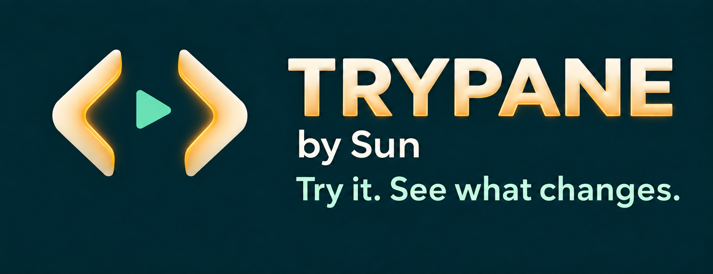

<!-- SUN BRANDING START -->
# TryPane by Sun


<!-- SUN BRANDING END -->

TryPane is an embeddable **Try It** pane for testing code and inspecting results alongside a host editor or reference tool.

[Development milestones](docs/roadmap/MILESTONES.md)

## Run the demo locally

Use Node.js 24 and Python 3. From the repository root:

```sh
npm ci
npm test
python3 -m http.server 8000 --bind 127.0.0.1
```

Open <http://127.0.0.1:8000/demo/>. Edit the sample, select **Run**, then try cancelling and running again. Use **Simulate failure** to check error recovery. The demo uses a fake runner that echoes the submitted text and counts its characters.

## Embed the pane

Import `mountTryPane` from the compiled `dist/src/pane.js` module. Pass a host element and options with `readInput`, a runner adapter, and `renderResult`. `readInput` returns a snapshot when the user selects **Run**. The adapter receives the same run ID and abort signal for both `load` and `run`. Use the cleanup function returned by `mountTryPane` when removing the pane.

## C# Regex preview

Build the pane with Node.js 24 and the local Regex runtime with the .NET 10 SDK and WebAssembly workload:

```sh
npm ci
npm test
dotnet workload install wasm-tools
bash tools-build-runtime.sh
python3 -m http.server 8000 --bind 127.0.0.1
```

Open <http://127.0.0.1:8000/demo/regex.html>. Select **First match** or **Find all** to inspect highlighted text and captures. The first run downloads a .NET WebAssembly bundle. The adapter keeps a healthy worker for repeat runs and replaces it after cancellation or timeout. Each PR's CI uploads a preview artifact containing the compiled pane, demo and runtime assets. Serve the artifact root over HTTP to inspect it.
